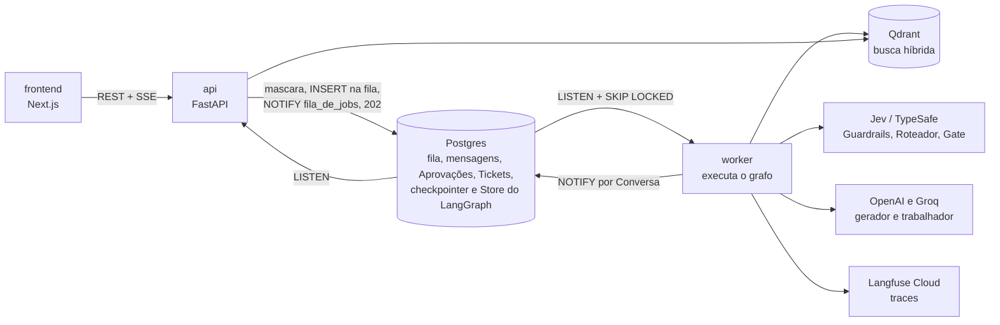

# Suporte Ampère

Chatbot de suporte ao Cliente da **Ampère Eletrônicos**, um e-commerce fictício, construído para um workshop ao vivo sobre engenharia de IA em produção. O Cliente conversa pelo chat; o chatbot responde dúvidas de política a partir da Base de Conhecimento (RAG híbrido no Qdrant), consulta Pedidos, emite Reembolsos (pedindo aprovação de um Atendente quando o Gate de Aprovação julga o caso crítico) e abre Tickets quando não consegue resolver. Por trás: um grafo do LangGraph com nove nós, o Jev (TypeSafe) como motor de todas as decisões rápidas, regras dessas decisões escritas em YAML legível, três papéis de modelo, Postgres para memória e fila, Langfuse para traces e dois evals com juiz calibrado contra rótulos humanos. Tudo pequeno o bastante para caber numa aula e completo o bastante para ser produção. Vocabulário em [CONTEXT.md](CONTEXT.md); decisões em [docs/adr](docs/adr).

## O grafo


A volta ao gerador acontece uma única vez: no caminho `duvida` ela vai para `gerar_resposta`, no caminho `transacao` para `agente`. Na segunda reprovação o grafo escala: abre um Ticket e devolve uma resposta fixa. Respostas fixas (bloqueio e escalada) não passam pelo Guardrail de saída, porque não foram escritas por um modelo. Tudo o que um modelo lê está em [backend/ampere/prompts](backend/ampere/prompts), e tudo o que o Jev decide está em [backend/ampere/regras](backend/ampere/regras), em YAML que qualquer pessoa lê: a pergunta, quando é sim, quando é não e o que acontece quando dispara.

## A infraestrutura



A api e o worker rodam a mesma imagem Docker com comandos diferentes e usam um pool de conexões. Não há Redis nem broker: a fila, a idempotência do `message_id`, o aviso que acorda o worker e o stream de eventos (LISTEN/NOTIFY → SSE) vivem no Postgres ([ADR 0004](docs/adr/0004-fila-e-stream-no-postgres.md)). O SSE entrega seis eventos: `token`, `tool_call`, `etapa` (um por nó do grafo, para o painel de bastidores do chat), `approval_required`, `message_done` e `error`. Cartão, CPF, CVV e senha são mascarados na api, antes de qualquer gravação.

## Como rodar

```bash
cp .env.example .env                      # sem chaves? MODELOS_FALSOS=true liga o modo demonstração
docker compose up -d postgres qdrant      # Postgres na 5439, Qdrant na 6333

cd backend && uv sync
uv run ampere migrate                     # tabelas da fila, das Conversas e do LangGraph
uv run ampere seed                        # três Clientes, Pedidos e um Reembolso recente
uv run ampere ingest                      # Base de Conhecimento no Qdrant (ou --todas: as seis coleções)
uv run ampere api                         # http://localhost:8000
uv run ampere worker                      # em outro terminal

cd ../frontend && npm install && npm run dev   # http://localhost:3000 (chat) e /atendente
```

Ou tudo de uma vez, incluindo api, worker e frontend em containers: `docker compose up --build`. Nesse caso rode `migrate`, `seed` e `ingest` de dentro do container: `docker compose run --rm api ampere migrate` (e o mesmo para `seed` e `ingest`). Todas as variáveis estão comentadas em [.env.example](.env.example). Com `MODELOS_FALSOS=true` o sistema roda inteiro sem nenhuma chave: dublês do gerador, do trabalhador e do Jev reagem à mensagem por palavras-chave, então dá para demonstrar dúvida, consulta de Pedido, Reembolso com e sem Atendente, escalada e bloqueios mesmo se a OpenAI ou o Jev caírem no dia (rode o `ingest` no mesmo modo, porque o embedder também vira falso).

**Testes:** `cd backend && uv run pytest`. Unitários e o teste do grafo inteiro rodam sem nada; os de integração (`-m integracao`) precisam de `DATABASE_URL` e `QDRANT_URL` apontando para o compose. Nenhum teste gasta token nem precisa de chave, e o [CI](.github/workflows/ci.yml) roda tudo assim. A regra de acoplamento da [ADR 0005](docs/adr/0005-organizacao-por-conceito.md) também é um teste. Frontend: `npm run lint && npx tsc --noEmit && npm run build`.

**Evals** (não são testes, ficam fora do pytest e gastam token): `uv run ampere-evals rag` (Recall@5 e MRR por coleção, com e sem ColBERT e self-querying, mais fidelidade e relevância pelo juiz), `uv run ampere-evals agente` (intenção, Ação e desfecho por código, veredito e crítica do juiz) e `uv run ampere-evals calibracao` (TPR, TNR, matriz de confusão, desacordos e Rogan-Gladen com bootstrap contra os rótulos humanos). Dados em [backend/ampere/evals/dados](backend/ampere/evals/dados).

## Custo por papel

Modelo caro não é para tudo ([ADR 0002](docs/adr/0002-tres-niveis-de-modelo.md)). Valores em USD por milhão de tokens, de `CUSTO_POR_PAPEL` em [backend/ampere/nucleo/modelos.py](backend/ampere/nucleo/modelos.py).

| Papel | Modelo | Entrada | Saída | Faz o quê |
|---|---|---|---|---|
| gerador | gpt-5.6-terra (OpenAI) | 2,50 | 10,00 | escreve para o Cliente e escolhe as Ações |
| juiz | gpt-5.6-sol (OpenAI) | 15,00 | 60,00 | só nos evals; avalia respostas com crítica |
| trabalhador | openai/gpt-oss-120b (Groq) | 0,15 | 0,60 | extrai memórias, resume Conversas e Tickets, self-querying |

O Jev não entra na tabela: não gera texto, responde perguntas tipadas com probabilidade calibrada em milissegundos ([ADR 0001](docs/adr/0001-jev-decide-llm-escreve.md)).

## Índice na ordem da aula

A ordem em que uma mensagem atravessa o sistema. Cada pasta tem um README curto: o que é, por que foi feito assim e um parágrafo de teoria.

1. [api](backend/ampere/api), [fila](backend/ampere/fila) e [conversas](backend/ampere/conversas): REST, mascaramento na borda, 202 idempotente, worker com SKIP LOCKED, NOTIFY e os eventos do SSE
2. [grafo](backend/ampere/grafo): os nove nós, o estado e o executor
3. [prompts](backend/ampere/prompts) e [regras](backend/ampere/regras): tudo o que os modelos e o Jev leem, em texto
4. [guardrails](backend/ampere/guardrails): entrada, saída e mascaramento
5. [roteador](backend/ampere/roteador): a intenção que escolhe o caminho
6. [rag](backend/ampere/rag): chunkers, embedders, busca híbrida, ColBERT e self-querying
7. [acoes](backend/ampere/acoes) e [loja](backend/ampere/loja): as quatro Ações, o Gate de Aprovação e o human-in-the-loop do Reembolso
8. [memoria](backend/ampere/memoria): Semântica, Episódica e Procedural
9. [observabilidade](backend/ampere/observabilidade): Langfuse, sessões e spans do Jev
10. [evals](backend/ampere/evals): RAG, agente, calibração do juiz e a Tela de Avaliação (`/avaliacao`), com a amostra ao vivo
11. [nucleo](backend/ampere/nucleo): config, fábrica de modelos, Jev, falsos, banco e migrações

Também: [frontend](frontend), [tests](backend/tests), [CONTEXT.md](CONTEXT.md) (glossário), a raiz de composição em [backend/ampere/composicao.py](backend/ampere/composicao.py) e as ADRs:

- [0001 Jev decide, LLM escreve](docs/adr/0001-jev-decide-llm-escreve.md)
- [0002 Três papéis de modelo: gerador, juiz e trabalhador](docs/adr/0002-tres-niveis-de-modelo.md)
- [0003 Qdrant como único índice de busca, uma coleção por variante](docs/adr/0003-qdrant-como-unico-indice-de-busca.md)
- [0004 Fila, idempotência e stream de tokens no Postgres](docs/adr/0004-fila-e-stream-no-postgres.md)
- [0005 Backend organizado por conceito de domínio, não por camada](docs/adr/0005-organizacao-por-conceito.md)
- [0006 Identificadores de domínio em português, técnicos em inglês](docs/adr/0006-dominio-em-portugues.md)
- [0007 Regras do Jev em YAML legível, fora do código](docs/adr/0007-regras-do-jev-em-yaml.md)
- [0008 Fornecedores atrás de interfaces do projeto, sem reorganizar em camadas](docs/adr/0008-fornecedores-atras-de-interfaces.md)
- [0009 Avaliação ao vivo pela mesma fila e pelo mesmo stream do chat](docs/adr/0009-avaliacao-ao-vivo-pela-fila.md)
- [0010 Login com sessão no Postgres e frontend como BFF](docs/adr/0010-login-com-sessao-e-frontend-como-bff.md)

Deploy em produção, com cinco serviços no Railway: [docs/railway.md](docs/railway.md). Licença [MIT](LICENSE).
